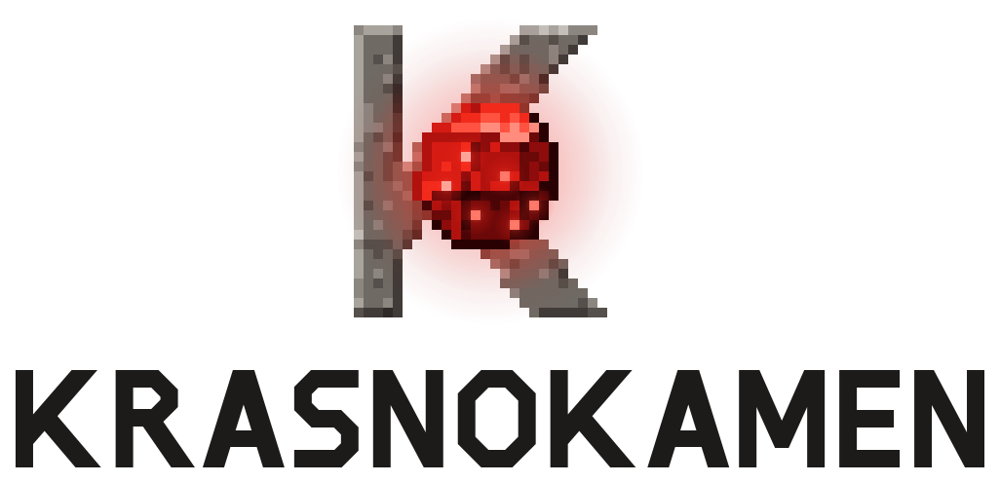
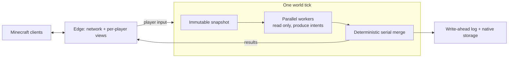

<p align="center">
  <picture>
    <source media="(prefers-color-scheme: dark)" srcset="docs/brand/krasnokamen-logo-on-dark.svg">
    
  </picture>
</p>

<p align="center">
  <b>An engine for large Minecraft-compatible simulations.</b><br>
  A Minecraft: Java Edition server rebuilt from scratch in Rust.<br>
  Parallel ticks · deterministic outcomes · WAL-backed saves · sandboxed Wasm plugins
</p>

<p align="center">
  <sub><b>Krasnokamen 1.0.0-rc.5 «Pauline»</b> · formerly Solaris (<a href="docs/brand/README.md#formerly-solaris">why the name changed</a>)</sub>
</p>

<p align="center">
  <a href="https://github.com/kaiserproger/krasnokamen/releases"></a>
  <a href="https://github.com/kaiserproger/krasnokamen/actions/workflows/ci.yml"></a>
  
  
  <a href="#license"></a>
</p>

<p align="center">
  <a href="https://github.com/kaiserproger/krasnokamen/releases"><b>Download</b></a> ·
  <a href="#quick-start"><b>Quick start</b></a> ·
  <a href="#how-it-works"><b>How it works</b></a> ·
  <a href="#the-krasnokamen-ecosystem"><b>Ecosystem</b></a> ·
  <a href="docs/README.md"><b>Docs</b></a> ·
  <a href="CONTRIBUTING.md"><b>Contribute</b></a>
</p>

> [!IMPORTANT]
> **Krasnokamen 1.0 "Pauline" is a release candidate (RC5, prerelease).** Survival,
> multiplayer, crash recovery and real-client compatibility are tested on every
> release, and each release's notes list what was validated and what is known to
> be unsupported. Gameplay is vanilla-like, not bit-identical, and Java mods do not
> run. Back up worlds before trusting it with a long-running server.

## What is Krasnokamen?

Krasnokamen is an independent Minecraft: Java Edition server written from scratch in
Rust. It is a full server, not a framework: it reimplements the game itself, from
world generation, mobs and redstone to villages, combat and inventories. Players
join with a **normal, unmodified Minecraft Java client**. **Version support:**
every release from **26.1.2 through 26.3** (775, 776, 777); canonical is 26.3.
Content import and first start install each version's cache automatically
([details](docs/OPERATING.md#client-protocol-compatibility)). A bump adds a
translation step without dropping older versions. No client mods or launcher tricks.

It is built for the things the vanilla server is bad at:

<table>
<tr>
<td width="50%" valign="top">

**⚡ Every core, one outcome.**
Vanilla simulates a world on essentially one thread. Krasnokamen runs the expensive
per-entity work on all cores, and the result stays deterministic: the same inputs
always produce the same world.

**🛡️ Recovery by design.**
The native store and tick write-ahead log cover world, inventory, container and
plugin data. Crash and restart scenarios test recovery; unflushed work can roll
back. RC5 still has recovery gaps, so keep backups.

</td>
<td width="50%" valign="top">

**🧩 Plugins that cannot take the server down.**
Plugins are WebAssembly components in a Wasmtime sandbox. They declare the
capabilities they need, cannot read your files or block the tick, and their data
commits in the same log as the world.

**🏘️ Villages that run themselves.**
Settlements plan and build houses, workshops, mines and storage from real
materials. Villagers take jobs, keep them across nights, trade and raise an
army, all managed through server-driven dialogs that work in a vanilla client.

</td>
</tr>
</table>

## How it works



- **Snapshot, intents, merge.** Each tick, workers on all cores read an immutable
  snapshot of the world and return *intents* such as "move here" or "attack that".
  A single merge step applies them in a fixed order, so parallelism never changes
  the outcome.
- **Data laid out for the CPU.** Hot entity fields sit in dense columns and rare
  data lives out of line, so a pass over 100,000 mobs touches far less memory.
- **Storage that follows the tick.** A native database plus the tick log is the
  only save format. Vanilla Anvil worlds are imported and exported with an
  offline command; the import keeps unknown data verbatim.
- **The game tick never waits on the network.** Networking and per-player view
  tracking run on their own threads.

Deep dive: [architecture overview](docs/ARCHITECTURE.md) ·
[persistence](docs/architecture/persistence.md) ·
[operating guide](docs/OPERATING.md).

## What works today

| Area | What you get |
| :-- | :-- |
| **Survival** | Mining, crafting, smelting, farming, breeding, enchanting, anvils, brewing, trading, beds, death and respawn, statistics, advancements |
| **World** | Vanilla-style terrain, biomes, caves, villages and structures; the Nether and the End with portals and the ender dragon fight |
| **Mobs** | Passive, neutral and hostile mobs, mounts and vehicles, raids, piglin bartering, iron and snow golems, the warden and sculk |
| **Redstone** | Pistons, hoppers, comparators, observers and the crafter |
| **Newer content** | Trial chambers, vaults, mace, wind charges, copper golems, bees, allays, elytra and beacons |
| **Multiplayer** | Many players in one world, chat, teams and scoreboards |
| **Operators** | Console, bans and whitelist, live backups, block and container history (`/co`), RCON, Query, Velocity forwarding, anti-xray, Distant Horizons support and an optional read-only web dashboard |

Krasnokamen targets the vanilla network protocol and supports offline Anvil world
import and export, with compatibility still partial. Gameplay aims to feel like
vanilla, not to be bit-identical: exact AI timing and vanilla bugs are not
reproduced. Map-making support is partial: directory `/function` datapacks,
command blocks, `/clone`, storage `/data` and `/execute` work within
[documented limits](docs/OPERATING.md#datapacks-and-command-blocks); ZIP and worldgen
datapacks do not load yet. The per-feature picture is in
[compatibility](docs/COMPATIBILITY.md).

### Settlements

Villages are settlements that run themselves. A planner lays out and builds
houses, workshops, storage, mines and camps from real materials. Villagers take
building, mining and lumber jobs, keep their work across nights, raise an army and
trade through a settlement economy. Players claim and manage a settlement through
server-driven dialogs, with no client mod. Start with the
[player guide](docs/SETTLEMENTS_GUIDE.md), or `/settlement guide` in game.

## The Krasnokamen ecosystem

| Project | What it is |
| :-- | :-- |
| **[Krasnokamen](https://github.com/kaiserproger/krasnokamen)** | This repository: the server core, deterministic simulation, storage, protocol and validation tooling |
| **[Krasnokamen Client](https://github.com/kaiserproger/krasnokamen-client)** | Optional native Rust client (wgpu: Vulkan, Metal, DX12) with its own launcher and singleplayer: Low/Medium/High presets (HDR, bloom, shadows, god rays, reflections), GPU-generated far terrain, proximity voice chat and screen sharing to in-world monitors |
| **[Default Plugins](https://github.com/kaiserproger/krasnokamen-default-plugins)** | Ready-made Wasm packages: permissions, essentials, economy, towns with natively enforced chunk claims, audit, offline-mode authentication, graves and more |
| **[Krasnokamen Loader](https://github.com/kaiserproger/krasnokamen-loader)** | Optional client mod (Fabric, NeoForge, Forge) for plugins that add client-side content |

Vanilla clients need none of the optional pieces. Server-only plugins work with
vanilla clients.

> [!NOTE]
> **Forge, Fabric, NeoForge and Bukkit/Paper plugins do not run on Krasnokamen.** In
> All the Mods 11, 215 of 289 mods ship server-side Java and 152 rewrite Minecraft
> internals with Mixins; there is no JVM to host them. Server features are written
> as [Wasm plugins](docs/PLUGINS.md), in Rust with the [SDK](sdk/rust/) or any
> language that compiles to WebAssembly components. Start with the
> [plugin quickstart](docs/plugins/QUICKSTART.md).

## Performance

Measured, not promised. Four reproducible release profiles cover an idle world,
exploration and dense entity simulation, each from **one documented command** with
receipts. Results below: tree `74aed9fc`, 2026-11-13, exclusive measurement window,
120 s measured after 30 s warmup; setup and smoke runs are never published as
performance numbers.

| Profile | Players / bots and entity load | Server RSS peak / steady | MSPT p50 / p95 / p99 / max | TPS |
|---|---|---|---|---|
| Idle world | 0 clients, generated Overworld | 271 / 265 MiB | 0.22 / 0.33 / 0.43 / 3.6 ms | 20.00 |
| Exploration | 20 protocol bots exploring fresh terrain | 679 / 673 MiB | 8.6 / 27.7 / 33.0 / 50.3 ms | 20.00 |
| Native-100 | 100 protocol bots + 100,000 mixed mobs | 1,676 / 1,612 MiB | 63.5 / 79.2 / 88.6 / 210.7 ms | 15.17 |
| Villager-heavy | 100 protocol bots + 100,000 mixed mobs + 20,000 villagers | 2,096 / 2,073 MiB | 141.5 / 160.0 / 171.4 / 180.0 ms | 7.07 |

Reference host: Ryzen 5 7535HS (6 cores / 12 threads), 32 GB RAM, NVMe SSD,
Ubuntu 26.04.1. Already measured: the single-threaded in-process terrain
generator takes **13.8–17.3 ms per chunk** across three seeds (lighting, storage
and networking excluded; this is not server chunk throughput). Conditions, metric
definitions and one-command reproduction: [profiles](docs/performance/PROFILES.md)
and [benchmarks](docs/performance/BENCHMARKS.md).

## Built to be trusted

Krasnokamen is tested the way players break servers:

- **7,300+ Rust tests** across the workspace, plus crash and restart tests that
  kill the server mid-checkpoint and check that the world comes back whole.
- **Real-client gates:** graphical Minecraft clients under Xvfb play scripted
  scenarios including inventory, mounts and autonomous villages against a
  release build.
- **A public bug ledger:** 334 bugs tracked with their original repro; each of the
  132 fixed rows lists a regression check. Cargo checks run on integration; client
  checks run in the client tier. See [the ledger](docs/bugs/README.md).

Since the first commit on 2026-05-12: 1,593 commits and 750,000+ lines of Rust in
this repository alone.

<details>
<summary><b>Milestones</b></summary>

| Date | Milestone |
| :-- | :-- |
| 2026-05-12 | Project bootstrap; protocol, world generation and other systems followed |
| 2026-08-28 | `v0.0.2-alpha.1` |
| 2026-09-09 | Loader and default plugins become their own repositories |
| 2026-09-19 | `v0.0.7`: Wasm plugins, settlements |
| 2026-10-18 | `v0.0.8`: **Core v2** (one logical tick, parallel snapshot reads, deterministic merge, native storage and tick WAL) |
| 2026-10-19 | Native Rust client and launcher |
| 2026-10-29 | `v1.0.0-rc.1` "Pauline": Minecraft Java 26.3 |
| 2026-11-07 | `v1.0.0-rc.5` |
| 2026-11-12 | Renamed from Solaris to Krasnokamen ([why](docs/brand/README.md#formerly-solaris)) |

</details>

## Quick start

Linux x86-64 and AArch64 binaries are published on
[GitHub Releases](https://github.com/kaiserproger/krasnokamen/releases). You need
`curl`, `tar`, a SHA-256 utility and **JDK 25** (used once to extract game data).
rc.5 artefacts predate the rename (archive `solaris-<target>.tar.gz`, binary
`solaris`, `SOLARIS_*` variables); the next release ships `krasnokamen-*` artefacts.

```sh
curl -fsSL https://raw.githubusercontent.com/kaiserproger/krasnokamen/v1.0.0-rc.5/install.sh \
  | SOLARIS_VERSION=v1.0.0-rc.5 bash
curl -fsSLo example.toml \
  https://raw.githubusercontent.com/kaiserproger/krasnokamen/v1.0.0-rc.5/example.toml
```

Krasnokamen does not ship any Mojang files. Before the first start, let it download the
official server once and derive its game data from it:

```sh
solaris content import --version 26.3 --download
solaris --config example.toml
```

Then connect a Minecraft Java 26.3 client to `127.0.0.1:25565`.

> [!CAUTION]
> The example config listens on all interfaces with **offline authentication**.
> For anything beyond local testing, set `[auth].online_mode = true` and review
> `[network].bind_address` and your firewall.

The first start creates an empty `plugins/` directory next to the config; copy
packages from the [default plugins](https://github.com/kaiserproger/krasnokamen-default-plugins)
at tag `v1.0.0-rc.5` into it and restart to deploy them. Deploying that release's
`solaris-auth` locks every new session until the player runs `/register` or `/login`.

To bring an existing vanilla world, stop the server and convert it once:

```sh
solaris --config example.toml world import-anvil \
  --source /worlds/my-vanilla-world --destination /worlds/native --receipt import.json
```

`world export-anvil` converts back. Configuration, backups and the console are
covered in the [operating guide](docs/OPERATING.md).

## Build from source

Install the Rust toolchain pinned in [`rust-toolchain.toml`](rust-toolchain.toml)
and JDK 25. Linux x86-64 builds use Clang and mold, as configured in
[`.cargo/config.toml`](.cargo/config.toml).

The code still uses the Solaris names until the rename lands in the source tree:

```sh
cargo build -p mc-edge --bin solaris-v2
cargo run -p mc-edge --bin solaris-v2 -- content import --version 26.3 --download
cargo run -p mc-edge --bin solaris-v2 -- --config example.toml
```

To use server jars you already have, replace `--download` with
`--from /path/to/26.3/server.jar --gameplay-from /path/to/26.1.2/server.jar`
(see [the content cache](docs/OPERATING.md#vanilla-content-cache)).

## FAQ

**Do players need a special client?** No. The unmodified Minecraft Java 26.3
client joins directly. The Krasnokamen Client is an optional extra.

**Can I run my Paper plugins or Fabric mods?** No; see the note under
[the ecosystem](#the-krasnokamen-ecosystem). Write a Wasm plugin instead, or use a
[default plugin](https://github.com/kaiserproger/krasnokamen-default-plugins).

**Is it production-ready?** Not yet: 1.0 is in release-candidate testing. Each
release's notes list what was validated and what is still unsupported.

**Does it contain Mojang code or assets?** No. Game data is derived on your
machine from the official server download.

## Contributing

Bug reports with a reproduction, focused fixes and documentation improvements are
welcome. Read [CONTRIBUTING.md](CONTRIBUTING.md) first. One command runs the full
check (format, lint, architecture rules, regressions and the whole test suite):

```sh
python3 -m tools.harness run correctness
```

More: the [documentation index](docs/README.md), the
[architecture overview](docs/ARCHITECTURE.md) and the
[RC5 release notes](docs/releases/v1.0.0-rc.5.md) (upgrading from v0.0.8 is
covered in the [RC1 notes](docs/releases/v1.0.0-rc.1.md)).

## License

Dual-licensed under [Apache-2.0](LICENSE-APACHE) or [MIT](LICENSE-MIT), at your
option.

<sub>Krasnokamen is unofficial and independent. It is not approved by or affiliated
with Mojang Studios or Microsoft. Minecraft is a trademark of Mojang AB.</sub>
