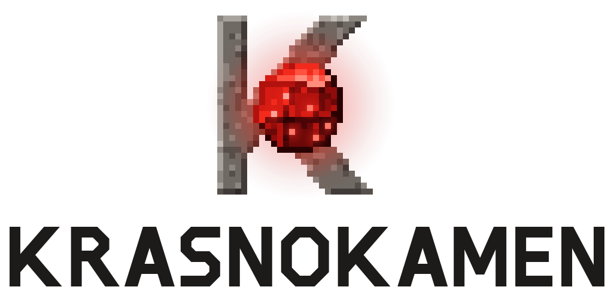

# Krasnokamen brand

<p>
  <picture>
    <source media="(prefers-color-scheme: dark)" srcset="krasnokamen-logo-on-dark.svg">
    
  </picture>
</p>

Krasnokamen is an engine for large Minecraft-compatible simulations. This page
holds its logo files, colours, type and naming rules. Every asset here is
original art drawn for the project: no Mojang textures, no Minecraft imagery.

## Name

- Write **Krasnokamen**: one word, capital K, the rest lower case. Not
  "KrasnoKamen", "Krasno Kamen", "Krasnokamen Engine" or "KK".
- Meaning: from Russian «красный камень», "red stone". The mark sets a red
  stone, drawn as a pixel texture that glows like redstone under shader light,
  into a pixel K. It is drawn for the project, never copied from a Mojang
  texture, and never shows torches, wires or circuits.
- English pronunciation: **kras-NO-ka-men**.
- Components keep the name in front: Krasnokamen Client, Krasnokamen Loader,
  Krasnokamen Default Plugins.
- Code uses the lower-case id `krasnokamen`: the binary, crates and packages
  (`krasnokamen-*`), identifiers (`krasnokamen_*`), namespaces and channels
  (`krasnokamen:*`). Environment variables use `KRASNOKAMEN_*`. Upper case
  KRASNOKAMEN appears only in the wordmark and in environment variables.
- Describe compatibility, never affiliation: "Minecraft-compatible", "for
  Minecraft: Java Edition". Keep the notice that the project is not approved by
  or affiliated with Mojang Studios or Microsoft.

## Formerly Solaris

Until 2026-11-12 the project was called **Solaris**. It was renamed because
SOLARIS is a live US trademark of two companies in the same class of goods
(class 9, software):

- Oracle America, Inc.: US Reg. No. 1863585, computer operating system and
  utility software ([USPTO record](https://tsdr.uspto.gov/statusview/sn74452720));
- Atari Interactive, Inc.: US Reg. No. 7213105, recorded computer and video
  game software ([USPTO record](https://tsdr.uspto.gov/statusview/rn7213105)).

Old release notes, decision records and the bug ledger keep the name Solaris
where they describe the past. Write "Krasnokamen (formerly Solaris)" once when
a reader may know the old name; otherwise use Krasnokamen alone.

## Files

| File | Use |
| :-- | :-- |
| [`krasnokamen-logo-on-light.svg`](krasnokamen-logo-on-light.svg) | Primary logo for light backgrounds: the mark, the wordmark centred below it |
| [`krasnokamen-logo-on-dark.svg`](krasnokamen-logo-on-dark.svg) | Primary logo for dark backgrounds: light wordmark, stronger glow |
| [`krasnokamen-wordmark-on-light.svg`](krasnokamen-wordmark-on-light.svg), [`krasnokamen-wordmark-on-dark.svg`](krasnokamen-wordmark-on-dark.svg) | Wordmark alone, where the mark already appears nearby |
| [`krasnokamen-mark-on-light.svg`](krasnokamen-mark-on-light.svg), [`krasnokamen-mark-on-dark.svg`](krasnokamen-mark-on-dark.svg) | The mark alone (the K and its stone), transparent |
| [`krasnokamen-icon.svg`](krasnokamen-icon.svg) and `krasnokamen-icon-{16,32,64,256,512}.png` | Square app, launcher and favicon icon: the mark on a Stone 900 tile. The 32 px PNG is the 32 × 32 mark pixel for pixel; the 16 px PNG is the stone alone |

The wordmark is drawn as outlined SVG paths, so no font is needed to show it.
Never retype KRASNOKAMEN in a font to imitate it; use the files.

In a GitHub README, let the reader's theme pick the variant:

```html
<picture>
  <source media="(prefers-color-scheme: dark)" srcset="https://raw.githubusercontent.com/kaiserproger/krasnokamen/main/docs/brand/krasnokamen-logo-on-dark.svg">
  
</picture>
```

## Mark and wordmark

The mark is a 32 × 32 pixel picture: the K of the wordmark, drawn in grey
stone, with a red stone set into its heart where the arm and the leg meet the
stem. The stone is a 16 × 16 texture, the size of a block texture: eight
facets lit from the top left, light ridges where a facet meets a darker one,
a dark outline on the shadow side and six glowing specks. A red bloom around
the stone and each speck, and red light spilling onto the grey K, give it the
look of an emissive block under shaders. The wordmark is a set of chiselled
capitals: square stems, and every curve cut into straight 45° facets (the O is
an octagon). In the logo the wordmark sits centred below the mark.

- Clear space: keep free space of at least a quarter of the logo's width on
  every side.
- Minimum size: the logo at 160 px wide; the mark alone at 32 px. Below 64 px use
  the icon PNGs, which are drawn at exact pixel sizes. Where you choose the size
  of the mark, prefer whole multiples of 32 px.
- Do not recolour, outline, rotate, stretch, shadow or animate the mark or the
  wordmark, smooth or blur its pixels, add more glow, rearrange the logo, place
  it on a busy picture, or combine it with Minecraft or Mojang logos and
  textures.

## Colour

Brand red is **`#D51B13`**. The red ramp exists to draw the stone's texture;
use brand red alone for accents, links and highlights. Stone greys carry text
and surfaces.

| Name | Hex | Use |
| :-- | :-- | :-- |
| Red 50 | `#FFD3CA` | Hottest specks, in the light |
| Red 100 | `#FF8C7C` | Glowing specks |
| Red 200 | `#FF5241` | Lit pixels; red text on Stone 900 |
| Red 300 | `#F22A1C` | Upper, lit face |
| **Red 500 (brand red)** | **`#D51B13`** | Front face, accents, badges |
| Red 600 | `#B2120E` | Middle face |
| Red 700 | `#8E0C0B` | Lower face |
| Red 800 | `#6B0808` | Shadow |
| Red 900 | `#4A0406` | Deep shadow |
| Red 950 | `#2A0103` | Outline on the shadow side |
| Stone 50 | `#F5F3F1` | Wordmark and text on dark |
| Stone 100 | `#E9E6E3` | Light surfaces, panels |
| Stone 300 | `#C4BFBA` | Secondary text on dark, rules on light |
| Stone 500 | `#8C8681` | Muted text, disabled controls |
| Stone 700 | `#4E4A46` | Secondary text on light, rules on dark |
| Stone 800 | `#2F2C2A` | Raised dark surfaces |
| Stone 900 | `#1D1B1A` | Wordmark on light, dark backgrounds, icon tile |

The grey K uses Stone 300, Stone 500 and Stone 700 with in-between tones for its
bevel and grain; near the stone those pixels are tinted towards red by the
stone's light. On dark backgrounds (the `-on-dark` files, the icon and the
social preview) the glow is stronger; on light backgrounds it is softer, so it
does not muddy the page.

## Type

- Wordmark: custom drawn; only from the SVG files.
- Running text and headings: a neutral grotesque sans serif. Use Inter where
  you control the font, otherwise the system UI stack
  (`system-ui, -apple-system, "Segoe UI", Roboto, "Helvetica Neue", Arial, sans-serif`).
  Headings semibold, sentence case; the product name in running text stays
  "Krasnokamen", never all capitals.
- Code, commands and identifiers: a monospace face (JetBrains Mono or the
  system monospace).
- The social preview sets its tagline and release line in Nimbus Sans, a
  Helvetica-metric grotesque.
